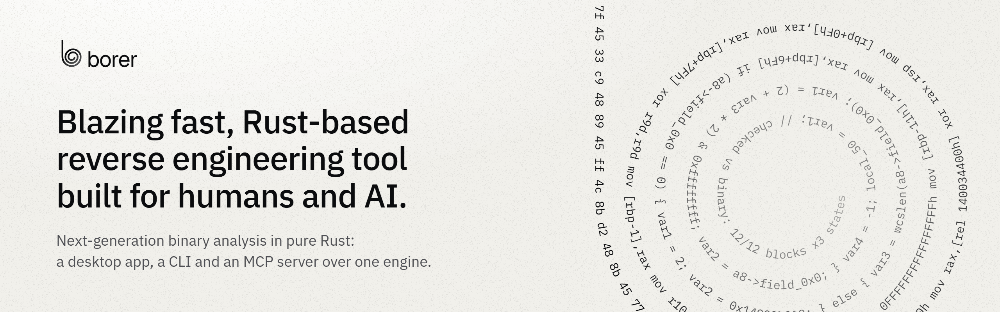
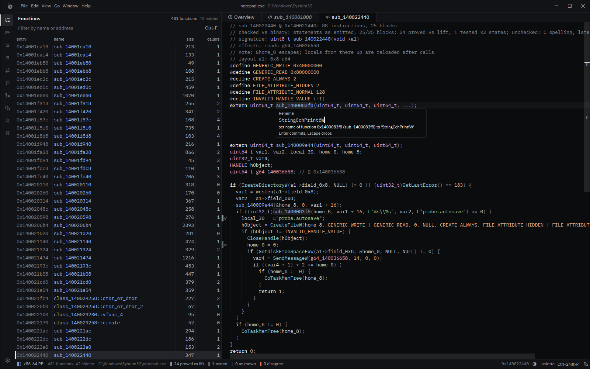
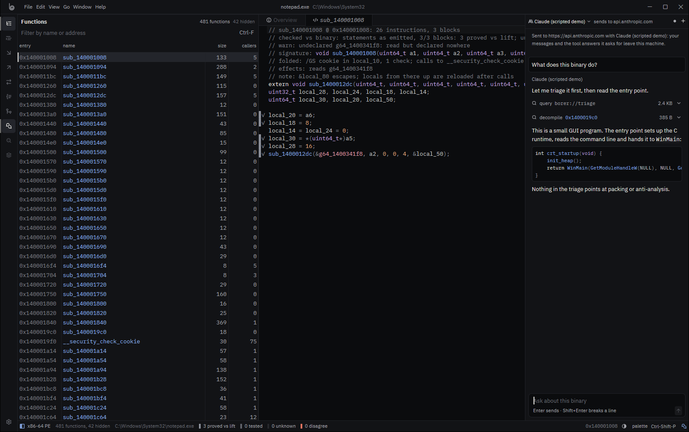

<p align="center">
  <a href="https://borer.lol">
    <picture>
      <source media="(prefers-color-scheme: dark)" srcset="brand/banner-dark.png">
      
    </picture>
  </a>
</p>

<p align="center">
  <a href="https://github.com/imjustprism/borer/releases/latest"></a>
  <a href="https://github.com/imjustprism/borer/actions/workflows/ci.yml"></a>
  <a href="LICENSE"></a>
  <a href="rust-toolchain.toml"></a>
  <a href="#a-desktop-app-held-to-the-same-bars"></a>
  <a href="#command-line-and-mcp-server"></a>
</p>

<p align="center">
  <a href="https://borer.lol"><b>borer.lol</b></a> &nbsp;·&nbsp;
  <a href="https://borer.lol/docs">Docs</a> &nbsp;·&nbsp;
  <a href="#install">Install</a> &nbsp;·&nbsp;
  <a href="#a-desktop-app-held-to-the-same-bars">Desktop app</a> &nbsp;·&nbsp;
  <a href="#command-line-and-mcp-server">MCP</a> &nbsp;·&nbsp;
  <a href="#what-it-does">Cases</a> &nbsp;·&nbsp;
  <a href="#fast-enough-to-read-everything">Benchmarks</a> &nbsp;·&nbsp;
  <a href="https://borer.lol/docs/tools">Tools</a> &nbsp;·&nbsp;
  <a href="https://borer.lol/llms.txt">llms.txt</a>
</p>

**Blazing fast, Rust-based reverse engineering tool built for humans and AI.**

borer is one pure Rust engine for the people who read binaries by hand and
for the AI agents that read them too. Its loader, lifters, emulator and
decompiler are its own Rust code, over format and instruction-decoder crates
(goblin, iced-x86, yaxpeax-arm); it never drives another reverse-engineering
tool underneath. Its emulator checks the decompiled text against the binary,
and the same query always gives the same bytes. One engine answers three
ways, each with the same facts:

- **Desktop app:** `borer-app` puts the engine in Zed's workspace: a function
  list, decompile, listing, graph and hex tabs, xrefs, types and the command
  palette. Each release attaches its installers for Windows, macOS and Linux.
  On one Windows machine it meets its frame, input, startup, open and memory
  bars ([measured below](#a-desktop-app-held-to-the-same-bars)).
- **Command line and scripts:** `borer <command>` answers in a terminal, and
  `borer script` runs a sandboxed Rhai script over the whole program.
- **MCP server:** `borer` with no arguments serves AI agents over MCP. Every
  list is paged and says how much it left out; triage and decompiles end with
  what to read next.

> [!WARNING]
> borer is early-stage. Tool names, output and resource URIs still change
> between releases. Please report anything that looks wrong.

<p align="center">
  <a href="brand/app-decompile.png"></a>
  <br>
  <sub>The desktop app on notepad.exe: the function list, a decompile tab with its check header, and an inline rename.</sub>
</p>

<p align="center">
  <a href="brand/app-chat.png"></a>
  <br>
  <sub>The chat panel, here driven by the app's scripted demo model: two tool calls, then an answer.</sub>
</p>

## What it covers today

| Part | What borer has | Measured |
| --- | --- | --- |
| Loader | PE, ELF, Mach-O, raw code and memory dumps; fuzzed in CI | a damaged file gets an error ([below](#a-hostile-file-gets-an-error-not-a-crash)); a load takes at most 8 bytes of heap per file byte (`tests/hostile.rs`, in the gate) |
| Disassembler | x86, x86-64, arm64, 32-bit ARM (A32, Thumb-2), RISC-V | |
| Decompiler | the same five; on all but RISC-V every function's header says how much of the text was checked against the binary | cold decompile 6.49 ms per function at p95 on notepad.exe (median of three runs); the gate holds it to 25 ms at p95 and 5 s at worst (`tests/bench.rs`) |
| Decompile check | `certify` runs the text as C beside the binary and grades it (x86, x86-64) | on ntdll's `sub_180102184`: grade `agrees`, 20 of 64 inputs agree, 44 unchecked and named, 0 differ ([below](#the-decompiler-checks-its-own-work)) |
| Emulator | x86, x86-64, arm64; runs one function on typed inputs, never the file; on x86 and x86-64 it also drives solving, unpacking, devirtualization, taint and struct recovery | ntdll's CRC-32 answers the published check value `0xcbf43926` ([below](#it-runs-code-without-running-the-file)) |
| Live process | read-only attach, objects by class, value and pointer-chain scans (Windows) | |
| MCP server | 42 tools and the `borer://` resources | notepad.exe triage in 2,408 bytes, ending with what to call next |
| Command line | the same binary; `borer help` lists every command | notepad.exe triage, 523 functions, in about 2.3 s |
| Desktop app | Zed's workspace, function list, decompile tabs, command palette (measured on Windows) | frame, input, startup, open and memory bars met ([table below](#a-desktop-app-held-to-the-same-bars)) |

These are borer's own numbers against its own bars, each measured on one
desktop machine (sources in
[Fast enough to read everything](#fast-enough-to-read-everything) and
[app/measurements.md](https://github.com/imjustprism/borer/blob/main/app/measurements.md));
this README publishes no head-to-head comparison with other tools. borer's
limits are listed in [docs/limits.md](https://github.com/imjustprism/borer/blob/main/docs/limits.md).

Everything below is real output of borer 0.2.12 (release build, commit
`7d9bb42c`) on two files of Windows 11: `notepad.exe` (sha256
`2d0b3948...2efb158f`) and `ntdll.dll` (sha256 `b072efae...ce5aed21`). Lines
cut for length are marked `...`. Addresses differ on another build:
`borer symbols ntdll.dll RtlComputeCrc32` finds the export, and its decompile
names the two functions it forwards to.

## What it does

### One call says what a file is and where to read

```console
$ borer triage notepad.exe
# PE x86-64, 360448 bytes, entry 0x1400019c0, 8 sections, 340 imports, 0 exports, 523 functions
# built: MSVC, cl 19.38 build 33145, Visual Studio 2022 17.8 (high: Rich header linker entry 0x102.33145; ...)
# protection: plain: no packer marks
# dynamic imports: 13 functions resolved at runtime, 1 library loaded, from 16 call site groups
# capabilities: 6 of 16 capabilities present across 340 imports
#   filesystem                CreateFileW, DeleteFileW, FindFirstFileW, ReadFile, WriteFile
#   persistence               RegCreateKeyExW, RegCreateKeyW, RegSetKeyValueW, RegSetValueExW
...
# blind spot: 4 of 18 GetProcAddress calls pass a name the decompiler cannot read (computed, hashed or decrypted): the imports resolved there stay unseen
# read first: no protection signal fired, so the ranking is by the strings and imports each function references
0x140013150  sub_140013150                references 13 strings and 47 imports
0x140012a28  sub_140012a28                references 38 strings and 3 imports
...
# next: function_summary(addr), then decompile(addr); emulate/<addr> runs one
```

The whole answer is 2,408 bytes. It ends with what to call next, and it names
its own blind spot instead of hiding it.

### The decompiler checks its own work

On x86, x86-64, arm64 and 32-bit ARM, every function's header says how much
of the text was checked against the machine code it came from:

```console
$ borer decompile ntdll.dll 0x180102184
// sub_180102184 @ 0x180102184: 6 instructions, 3 blocks
// checked vs binary: statements as emitted, 3/3 blocks: 3 proved vs lift; unchecked: C spelling, later text passes
// signature: uint64_t sub_180102184(uint64_t a1, uint8_t *a2, uint32_t a3)
...
if (a2 == nullptr) {
  return 0;
}
return sub_1800ed890(a1, a2, a3);
```

`certify` goes one step further: it runs the final text as C beside the
binary on the same inputs and grades the result.

```console
$ borer certify ntdll.dll 0x180102184
# certify for sub_180102184 (0x180102184): what of its decompilation was checked against the binary; agreement is evidence, not proof
lift	statements as emitted, 3/3 blocks: 3 proved vs lift; unchecked: C spelling, later text passes
text	20 of 64 inputs agree as ISO C, 44 unchecked, 0 differ (seed 1, 20000 steps each)
unchecked	44	the binary did not return: fault at 0x500000010050
reached	2 of 3 blocks; never reached: 0x180102191
grade	agrees	every input checked agrees (they reached 2 of 3 blocks) and no lifted block is contradicted
```

The block check covers x86, x86-64, arm64 and 32-bit ARM; RISC-V output has
no check header yet. `certify` runs on x86 and x86-64. The header always says
what was not checked (here the C spelling and the later text passes). An
instruction borer cannot model stays in the text as `/* asm: ... */`. It is
never replaced by a guess.

### It runs code without running the file

borer has its own emulator, so you or an agent can call a function on typed
inputs and read the result. Here the function `RtlComputeCrc32` forwards to gets the
standard CRC-32 test string, and answers the published check value
`0xcbf43926`. The last column says the decompiled text, run on the same
inputs, gave the same results:

```console
$ borer run ntdll.dll '0x1800ed890/0,"123456789",9;0,"",0;0,"a",1'
# run uint32_t sub_1800ed890(uint32_t a1, uint8_t *a2, uint64_t a3): 3 inputs, at most 1000000 steps each; the text agrees on 3, differs on 0, unchecked on 0
# args	returns	stop	steps	writes	text
0 "123456789" 9	0xcbf43926	returned	126	-	agrees
0 "" 0	0	returned	38	-	agrees
0 "a" 1	0xe8b7be43	returned	47	-	agrees
```

The same emulator drives input solving (`solve`), unpacking (`unpack`),
devirtualization (`devirt`), taint (`taint`) and struct recovery (`layout`).
The file itself is never executed and never modified.

### It says what it does not know

Ask the exported wrapper the same question and borer does not round its
answer up:

```console
$ borer run ntdll.dll 'RtlComputeCrc32/0,"123456789",9'
# run uint64_t RtlComputeCrc32(uint64_t a1, uint64_t a2, uint64_t a3): 1 input, at most 1000000 steps each; the text agrees on 0, differs on 0, unchecked on 1
...
0 "123456789" 9	0xcbf43926	returned	131	-	unchecked
# input 1 unchecked at line 6 `return sub_180102184(a1, a2, a3);`: the text states only the low 8 bits of the result; the bits above are the machine's own
```

A heuristic answer names its evidence. `borer why <address>` lists where
each fact about an address came from:

```console
$ borer why ntdll.dll 0x1800ed890
# 0x1800ed890 is the entry of sub_1800ed890: 864 bytes, 36 blocks, 215 instructions
# section .text at 0x180001000, r-x and code
# name: nothing names it, so the name is the address
# discovered by: an entry in the exception or symbol table, then 1 call site(s)
# referenced from 1 site(s): 0x18010218c in sub_180102184
```

### It finds code by what it is

```console
$ borer crypto ntdll.dll
# 17 crypto/hash constant hits: 6 algorithm(s) across 16 function(s)
# algorithm        sites  functions  where
CRC-32            8      3          data in .rdata, read by sub_18015431c, sub_180154538, crc32_fn
MD5               3      9          data in .rdata, read by sha1_or_ripemd160_fn, MD5Init, MD5Final, ...
SHA-256           2      2          data in .rdata, read by sha256_fn, sha256_or_blake2s_fn
...
```

```console
$ borer sig ntdll.dll 0x180102184
# signature of sub_180102184 at 0x180102184: 8 bytes, 1 wildcarded, unique in the image
pattern  48 85 D2 74 ?? 45 8B C0
...
```

Classes, vtables, message formats, opcode dispatchers, decoded and generated
strings, IOCs and YARA rules come from the same engine: `borer help` lists
every command, and `borer://help` every resource.

### Answers sized for a screen and a context window

Every list is filtered and paged on the server, and says how much it left
out:

```console
$ borer functions notepad.exe "" 0 3
# showing 3 of 481 functions; 39 import thunks left out, filter=thunk lists them; 3 exception funclets left out, filter=funclet lists them
# entry size blocks instrs callers callees src name
0x140001008 133 3 26 5 2 - sub_140001008
0x140001094 288 12 67 2 2 - sub_140001094
0x1400011bc 149 3 27 5 2 - sub_1400011bc
```

Over MCP an answer can also be asked again as a diff: see "Ask again, get
only what changed" below. Every answer ends with an evidence id; the session
keeps the text behind the last 256 ids, so a recent answer can be fetched
again exactly.

### Same question, same bytes

The same binary and the same query give the same bytes, on one core or all of
them, in any order. That is a tested contract, not a habit: the gate decompiles
a corpus twice and in parallel and compares.

```console
$ borer decompile notepad.exe 0x140013150 full 0 100000 | sha256sum
b45d12089ef2280f...
$ borer decompile notepad.exe 0x140013150 full 0 100000 | sha256sum
b45d12089ef2280f...
```

### A hostile file gets an error, not a crash

Reads are bounds-checked, scans capped and walks fuel-limited, and the
loaders are fuzzed in CI. The first 300 bytes of notepad.exe:

```console
$ borer triage cut.exe
Error: loading cut.exe

Caused by:
    the file starts like a PE but its headers do not parse, even leniently: it is truncated or damaged (300 bytes; ...)
```

### Fast enough to read everything

On notepad.exe (523 functions), `borer triage` loads, discovers and ranks the
whole file in about 2.3 seconds (release build `7d9bb42c`, three runs: 2.24,
2.41, 2.29 s). A cold decompile takes under 7 ms per function at the 95th
percentile (`tests/bench.rs`, release build `70b5db2c`, three runs: 6.64,
6.48, 6.49 ms). Both on one desktop machine. The time bars, 25 ms at p95 and
5 s at worst per function, are part of the gate. A person or an agent can
read every function instead of guessing where to look.

### A desktop app held to the same bars

`borer-app` is the engine in Zed's workspace: the function list in the left
dock, decompile tabs in the center, Zed's command palette, navigation history
and saved docks. No engine call runs on the UI thread. Release build
`c3f3742f`, AMD Ryzen 7 9800X3D, Windows ([app/measurements.md](https://github.com/imjustprism/borer/blob/main/app/measurements.md)):

| Measure | Result | Bar |
| --- | ---: | ---: |
| 100,000-row list scroll, frame draw p99 | 2.97 ms | 8.3 ms |
| 1,000,000-line code scroll, frame draw p99 | 2.62 ms | 8.3 ms |
| Input to paint p99, 200 keys and 100 clicks | 6.83 ms | 16 ms |
| First frame, median of 10 | 190.6 ms | 300 ms |
| notepad.exe open to its function list, median of 10 | 247.0 ms | 1 s |
| Memory beyond the engine | 87.1 MB | 150 MB |

Beside the function list and decompile tabs, the app has a linear listing,
control-flow graphs, a hex view, strings, imports, exports, xrefs, a call tree
and a types editor. Windows is the measured platform.

## Platforms

| Architecture | Disassemble | Decompile | Emulation tools |
| --- | :---: | :---: | :---: |
| x86, x86-64 | yes | yes | yes |
| arm64 | yes | yes | yes |
| 32-bit ARM (A32, Thumb-2) | yes | yes | no |
| RISC-V (RV32, RV64 GC) | yes | yes | no |

Formats: PE, ELF, Mach-O, raw code and memory dumps.

## Install

### Desktop app

Every release attaches the desktop app's installers beside the archives: an
MSI for Windows x64, a `.dmg` for macOS (arm64 and x64) and a `.tar.gz` for
Linux x64, with SHA256SUMS to check them. They are not signed yet, so each
system warns once; [packaging/borer-app/README.md](packaging/borer-app/README.md)
has the steps, and [Quick start](#quick-start) builds it from source.

### Command line and MCP server

macOS and Linux:

```bash
curl -fsSL https://borer.lol/install | sh
```

Windows (PowerShell):

```powershell
irm https://borer.lol/install.ps1 | iex
```

The installer downloads the latest release, checks it against the release's
SHA256SUMS and registers borer with every MCP client it finds: Claude Code,
Claude Desktop, Cursor, VS Code, Windsurf, Zed, Codex CLI, Gemini CLI and 20
more. Restart the clients it names afterwards.

Package managers install the same release binary:

```bash
cargo binstall borer                  # or cargo install borer
brew install imjustprism/tap/borer    # macOS, Linux x64
npm install -g @imjustprism/borer     # or npx -y @imjustprism/borer
pipx install borer                    # or uvx borer
```

On Windows with Scoop: `scoop bucket add imjustprism
https://github.com/imjustprism/scoop-bucket`, then `scoop install
imjustprism/borer`. In Claude Code: `/plugin marketplace add imjustprism/borer`,
then `/plugin install borer@borer`. From source, with the toolchain
`rust-toolchain.toml` pins: `cargo build --release`.

Register an installed binary with `borer setup --apply` (`borer setup` alone
shows each file and entry it would write, in each client's own format). Most
clients (Claude Desktop, Cursor, Windsurf, Gemini CLI and others) read
`mcpServers`, with the binary's absolute path:

```json
{ "mcpServers": { "borer": { "command": "/path/to/borer", "args": [] } } }
```

VS Code reads `servers` (with `"type": "stdio"`), Zed `context_servers`, and
Codex CLI `[mcp_servers.borer]` in its TOML; `borer setup` writes each in its
own format.

To uninstall, run `borer setup --apply --remove`, then delete the binary and
its cache (`%LOCALAPPDATA%\borer` or `~/.cache/borer`). The installers do all
three with `--uninstall` (`-Uninstall` in PowerShell).

## Quick start

In the desktop app, open a file (drop it on the window, or Ctrl+O) and the
function list fills; the command palette (Ctrl+Shift+P, Cmd+Shift+P on macOS)
lists every action. To build it from source, in its own cargo workspace under
`app/`: on Windows it needs the MSVC C++ x64 build tools, the Windows 10/11
SDK 10.0.20348 or newer, Rust 1.98.1, `git` and about 0.6 GB in Cargo's git
cache for the pinned Zed checkout (`app/Cargo.toml`); a clean release build
takes about 11 minutes:

```bash
cd app && cargo build --release
target/release/borer-app notepad.exe
```

From the command line:

```bash
borer triage    sample.exe
borer decompile sample.exe <address|name>
borer xrefs     sample.exe <address|name>
borer certify   sample.exe <address|name>   # how far the decompiled text was checked
borer help                                  # every command
```

`--pack <file>` loads target knowledge, `--no-pdb` skips the companion PDB, and
`--arch x86|x64|arm64` with `--base` and `--entry` maps raw code or a dump.

From an AI agent over MCP:

1. `load_binary`
2. read `borer://triage`: what the file is, how it is protected, where to start
3. `find_function_by_string`, `strings` or `symbols`
4. `function_summary`, then `decompile`
5. `xrefs`, `cfg` or `callgraph` to go wider

Any address argument takes `0x` hex, decimal or a name.

| Area | Tools |
| --- | --- |
| Load | `load_binary`, `binary_info`, `fetch_pdb`, `reload` |
| Find | `functions`, `function`, `symbols`, `strings`, `search`, `find_function_by_string`, `find_crypto_constants`, `entropy` |
| Read code | `function_summary`, `function_strings`, `decompile`, `decompile_batch`, `disassemble`, `disassemble_function`, `cfg`, `callgraph`, `reaches`, `xrefs`, `class_layout` |
| Read data | `read`, `hexdump` |
| Annotate | `set_name`, `set_comment`, `set_type`, `types`, `annotations`, `save_project`, `load_project` |
| Live process (Windows) | `live_attach`, `live_detach`, `live_modules`, `live_read`, `live_object`, `live_instances`, `live_watch`, `live_scan` |
| Anything else | `query`, `script` |

Deeper analyses are `borer://` resources: taint, struct layout, emulation,
input solving, unpacking, deobfuscation, binary diff, decoded strings, IOCs,
signatures and YARA rules. `borer://help` lists them all, and a client without
resource support passes the same URI to `query`.

## More of what it does

### Ask again, get only what changed

An agent renames a function and asks for the same decompile again. Instead of
the whole text a second time, borer sends the lines that differ. These three
calls are one MCP session on borer 0.2.12:

```console
> query borer://decompile/0x1800ed890!limit=12
# showing 12 of 113 from 0
// sub_1800ed890 @ 0x1800ed890: 215 instructions, 36 blocks
...
extern uint64_t sub_1800eddf4(uint64_t, uint64_t, uint64_t);
...
# since=8704869d
# evidence: 5-c9635f3d

> set_name address=0x1800eddf4 name=crc32_fold_wide dry_run=false
renamed function 0x1800eddf4: sub_1800eddf4 -> crc32_fold_wide

> query borer://decompile/0x1800ed890!limit=12!since=8704869d
# changed since the answer tagged 8704869d: 15 lines, 1141 bytes now; the lines that differ from that answer follow, ...
@@ -13,1 +13,1 @@
-extern uint64_t sub_1800eddf4(uint64_t, uint64_t, uint64_t);
+extern uint64_t crc32_fold_wide(uint64_t, uint64_t, uint64_t);
# since=0a3dc285
```

Ask once more with the new tag and the answer is one line:

```console
> query borer://decompile/0x1800ed890!limit=12!since=0a3dc285
# unchanged since the answer tagged 0a3dc285: 15 lines, 1141 bytes; this note stands in for that text, ...
```

Names, comments and types live in a session overlay, never in the binary, and
every change is a dry run until `dry_run=false`.

### A struct from what the code does through a pointer

`RtlInitUnicodeString` fills a `UNICODE_STRING`. borer recovers the three
fields from the accesses alone, and the decompile carries the layout and the
function's effects in its header:

```console
$ borer layout ntdll.dll RtlInitUnicodeString
# structure through rcx of RtlInitUnicodeString, from 4 access site(s)
# 3 field(s) over 0x10 bytes
# offset  size  access        seen
0x0      2/8   written       2x
0x2      2     written       1x
0x8      8     written       1x

$ borer decompile ntdll.dll RtlInitUnicodeString
// RtlInitUnicodeString @ 0x1800993c0: 19 instructions, 4 blocks
// checked vs binary: statements as emitted, 4/4 blocks: 2 proved vs lift, 2 tested x3 states; unchecked: C spelling, later text passes
// signature: void RtlInitUnicodeString(PUNICODE_STRING a1, PCWSTR a2)
// effects: writes a1, a1+8, a1+2
// layout a1: 0x2 u16, 0x8 u64
uint64_t var1;

*(uint64_t*)a1 = 0;
a1->field_0x8 = a2;
if (a2 != 0) {
  var1 = wcslen(a2);
  *(uint16_t*)a1 = (var1 * 2 >= 0xfffe ? 0xfffc : var1 * 2);
  a1->field_0x2 = (var1 * 2 >= 0xfffe ? 0xfffc : var1 * 2) + 2;
}
```

Reading `borer://layout/<fn>,apply=<Name>` plans the struct and names the
`set_type` calls that state it; after them every decompile names the fields.

A class borer recovered takes one field at a time, and keeps the rest of its
layout as recovered: `set_type(name=<class>, fields=["0x270:m_pipeline"])`, or
`set_type(address=<method>, var="field_0x270", name="m_pipeline")` at a method
that reads the field through its own object. Every method that takes the class
as `this` then prints `this->m_pipeline`, and `class_layout` marks the row
`stated`. Fields merge by offset into a user struct too; `replace=true` drops
the ones not restated, and with no fields every field stated of a class. A
project's stated fields are held to the code again when it loads: those of a
class the code contradicts are skipped, with the reason.

### One function, any inputs, no process

```console
$ borer emulate ntdll.dll iswdigit,a1=0x35
# ran iswdigit from 0x18012aa90 with a1=0x35: returned after 11 steps, 0 bytes written
# registers: rax=0x4 rcx=0x4 rdx=0x4 r8=0x0 r9=0x0 ...
```

The same spec takes registers, memory writes, a stop address, a step budget,
a trace and a dump (`borer help` shows the grammar). `borer://diverge` runs a
function on two inputs and names the first instruction where the paths part.

What borer does not do yet is in
[docs/limits.md](https://github.com/imjustprism/borer/blob/main/docs/limits.md).
It has no telemetry; the few things that reach the network are in
[docs/network.md](https://github.com/imjustprism/borer/blob/main/docs/network.md).

## Contributing

`python scripts/gate.py` runs what CI runs. The rules for people and coding
agents are in [`borer.rules`](borer.rules), and the terms for contributions in
[CONTRIBUTING.md](CONTRIBUTING.md).

| Crate | Role |
| --- | --- |
| [`borer-engine`](crates/borer-engine) | The analysis core: loading, lifting, emulation, decompilation. Pure and synchronous. |
| [`borer`](crates/borer) | The MCP server and CLI over the engine. |
| [`borer-front`](crates/borer-front) | What the server and the app share outside the engine: the default places, read from the environment, and writing a project file. |
| [`borer-live`](crates/borer-live) | Read-only access to a running process. |
| [`borer-fixtures`](crates/borer-fixtures) | Programs the tests decompile and check against their source. |
| [`borer-app`](app/borer-app) | The desktop app, in its own workspace under `app/` on Zed's crates. AGPL-3.0 only. |

## License

borer is free software under the [GNU Affero General Public License
v3.0](LICENSE) (AGPL-3.0-only). If you distribute borer or a modified version,
or let users interact with a modified version over a network, you must offer
its complete source under the same license. Versions 0.1.0 and 0.1.1 were
released under MIT. A commercial license is available for the main workspace
(the engine, server and live crates) where the AGPL does not fit: open an
issue or reach out on GitHub. The desktop app builds on GPL-3.0-or-later
crates of Zed, so it is AGPL-3.0 only and outside that license.

Third-party notices are in [NOTICE](NOTICE), and each release archive carries
the licenses of everything the binary links. Ghidra is a project of the NSA.
IDA and Hex-Rays are trademarks of Hex-Rays SA, Binary Ninja is a trademark of
Vector 35, and Claude is a trademark of Anthropic. borer is not affiliated with
or endorsed by any of them.
