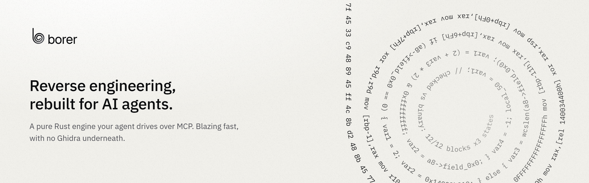

<p align="center">
  <a href="https://borer.lol">
    <picture>
      <source media="(prefers-color-scheme: dark)" srcset="brand/banner-dark.png">
      
    </picture>
  </a>
</p>

<p align="center">
  <a href="https://github.com/imjustprism/borer/releases/latest"></a>
  <a href="https://github.com/imjustprism/borer/actions/workflows/ci.yml"></a>
  <a href="LICENSE"></a>
  
</p>

<p align="center">
  <a href="https://borer.lol"><b>borer.lol</b></a> &nbsp;·&nbsp;
  <a href="https://borer.lol/docs">Docs</a> &nbsp;·&nbsp;
  <a href="#install">Install</a> &nbsp;·&nbsp;
  <a href="https://borer.lol/docs/tools">Tools</a> &nbsp;·&nbsp;
  <a href="https://borer.lol/llms.txt">llms.txt</a>
</p>

borer is a reverse-engineering engine built for AI agents. It loads a binary,
finds the code that matters, decompiles it to C, follows data through it and
keeps what it learns. It is one Rust binary: an MCP server when run with no
arguments, a command-line tool with them. There is no GUI, and no Ghidra, IDA
or Binary Ninja underneath.

> [!WARNING]
> borer is early-stage. Expect rough edges, and expect tool names, output and
> resource URIs to change between releases. Please report anything that looks
> wrong.

## Why borer

- **Checked output.** On x86, x86-64, arm64 and 32-bit ARM, the statements
  the lifter writes for each block are run on a model of the machine from
  seeded states and compared with the code they came from, and each
  function's header says what that covered and what it did not (the later
  text passes, the C spelling); RISC-V output is not checked yet. On x86 and
  x86-64, `borer certify` also runs a function's final text as C beside the
  binary and grades it. Instructions it cannot model stay as
  `/* asm: ... */` instead of a guess.
- **Sized for a context window.** Lists are filtered and paged on the server
  (`# showing N of M`), a repeated request with `since=<tag>` returns only
  what changed, and the same question always returns the same bytes.
- **Fast.** A typical binary loads and decompiles in seconds, so an agent can
  read every function instead of guessing where to look.
- **Safe on hostile input.** Reads are bounds-checked, scans capped and walks
  fuel-limited: a malformed or malicious file gets an error, never a crash.
  The binary is never modified, and annotations are dry runs by default.
- **Its own engine.** Loader, lifters, emulator, structurer and decompiler
  are written in Rust for this purpose. Only instruction decoding and file
  parsing come from standard crates.

Typical uses: malware triage and unpacking, vulnerability research with taint
and input solving, auditing closed libraries and firmware, and recovering
classes, protocols and message formats.

## Platforms

| Architecture | Disassemble | Decompile | Emulation tools |
| --- | --- | --- | --- |
| x86, x86-64 | yes | yes | yes |
| arm64 | yes | yes | yes |
| 32-bit ARM (A32, Thumb-2) | yes | yes | no |
| RISC-V (RV32, RV64 GC) | yes | yes | no |

Formats: PE, ELF, Mach-O, raw code and memory dumps.

## Install

macOS and Linux:

```bash
curl -fsSL https://borer.lol/install | sh
```

Windows (PowerShell):

```powershell
irm https://borer.lol/install.ps1 | iex
```

The installer downloads the latest release, checks it against the release's
SHA256SUMS and registers borer with every MCP client it finds: Claude Code,
Claude Desktop, Cursor, VS Code, Windsurf, Zed, Codex CLI, Gemini CLI and 20
more. Restart the clients it names afterwards.

Package managers install the same release binary:

```bash
cargo binstall borer                  # or cargo install borer
brew install imjustprism/tap/borer    # macOS, Linux x64
npm install -g @imjustprism/borer     # or npx -y @imjustprism/borer
pipx install borer                    # or uvx borer
```

On Windows with Scoop: `scoop bucket add imjustprism
https://github.com/imjustprism/scoop-bucket`, then `scoop install
imjustprism/borer`. In Claude Code: `/plugin marketplace add imjustprism/borer`,
then `/plugin install borer@borer`. From source, with the toolchain
`rust-toolchain.toml` pins: `cargo build --release`.

Register an installed binary with `borer setup --apply` (`borer setup` alone
shows each file and entry it would write, in each client's own format). Most
clients (Claude Desktop, Cursor, Windsurf, Gemini CLI and others) read
`mcpServers`, with the binary's absolute path:

```json
{ "mcpServers": { "borer": { "command": "/path/to/borer", "args": [] } } }
```

VS Code reads `servers` (with `"type": "stdio"`), Zed `context_servers`, and
Codex CLI `[mcp_servers.borer]` in its TOML; `borer setup` writes each in its
own format.

To uninstall, run `borer setup --apply --remove`, then delete the binary and
its cache (`%LOCALAPPDATA%\borer` or `~/.cache/borer`). The installers do all
three with `--uninstall` (`-Uninstall` in PowerShell).

## Quick start

From an agent:

1. `load_binary`
2. read `borer://triage`: what the file is, how it is protected, where to start
3. `find_function_by_string`, `strings` or `symbols`
4. `function_summary`, then `decompile`
5. `xrefs`, `cfg` or `callgraph` to go wider

Any address argument takes `0x` hex, decimal or a name.

| Area | Tools |
| --- | --- |
| Load | `load_binary`, `binary_info`, `fetch_pdb`, `reload` |
| Find | `functions`, `function`, `symbols`, `strings`, `search`, `find_function_by_string`, `find_crypto_constants`, `entropy` |
| Read code | `function_summary`, `function_strings`, `decompile`, `decompile_batch`, `disassemble`, `disassemble_function`, `cfg`, `callgraph`, `reaches`, `xrefs`, `class_layout` |
| Read data | `read`, `hexdump` |
| Annotate | `set_name`, `set_comment`, `set_type`, `types`, `annotations`, `save_project`, `load_project` |
| Live process (Windows) | `live_attach`, `live_detach`, `live_modules`, `live_read`, `live_object`, `live_instances`, `live_watch`, `live_scan` |
| Anything else | `query`, `script` |

Deeper analyses are `borer://` resources: taint, struct layout, emulation,
input solving, unpacking, deobfuscation, binary diff, decoded strings, IOCs,
signatures and YARA rules. `borer://help` lists them all, and a client without
resource support passes the same URI to `query`.

From the command line:

```bash
borer triage    sample.exe
borer decompile sample.exe <address|name>
borer xrefs     sample.exe <address|name>
borer certify   sample.exe <address|name>   # how far the decompiled text was checked
borer help                                  # every command
```

`--pack <file>` loads target knowledge, `--no-pdb` skips the companion PDB, and
`--arch x86|x64|arm64` with `--base` and `--entry` maps raw code or a dump.

## Network access

borer has no telemetry or crash reporting. Only these reach the network:

- A command line run at a terminal checks once a day for a newer release on
  GitHub. It never runs for the MCP server or under `CI`, and
  `BORER_NO_UPDATE_CHECK=1` turns it off.
- `fetch_pdb`, only when asked, sends the PDB's name, GUID and age to the
  symbol server, and `borer doctor` checks that server is reachable unless
  run as `borer doctor offline`.
- `borer update` and the installers download the release from GitHub. With
  `GH_TOKEN` or `GITHUB_TOKEN` set, `borer update` sends that token to
  GitHub's API (api.github.com) and nowhere else; the daily check never
  sends it.

## Limits

- 32-bit ARM and RISC-V are not emulated, so the emulator-backed analyses
  refuse them. On arm64, `taint`, `layout`, `solve`, `unpack` and `devirt`
  refuse to run.
- Shapes the structurer cannot prove stay as labels and gotos; SIMD code
  prints as intrinsics.
- No debugger: no breakpoints and no writes. Live access is Windows only.
- .NET IL and Swift are not decompiled, and DWARF supplies names and types,
  not line tables.
- Library signatures ship for LLVM compiler-rt, the Microsoft C++ standard
  library and the Rust standard library; build a pack for any other with
  `borer sigmake`.

## Contributing

`python scripts/gate.py` runs what CI runs. The rules for people and coding
agents are in [`borer.rules`](borer.rules), and the terms for contributions in
[CONTRIBUTING.md](CONTRIBUTING.md).

| Crate | Role |
| --- | --- |
| [`borer-engine`](crates/borer-engine) | The analysis core: loading, lifting, emulation, decompilation. Pure and synchronous. |
| [`borer`](crates/borer) | The MCP server and CLI over the engine. |
| [`borer-live`](crates/borer-live) | Read-only access to a running process. |
| [`borer-fixtures`](crates/borer-fixtures) | Programs the tests decompile and check against their source. |

## License

borer is free software under the [GNU Affero General Public License
v3.0](LICENSE) (AGPL-3.0-only). If you distribute borer or a modified version,
or let users interact with a modified version over a network, you must offer
its complete source under the same license. Versions 0.1.0 and 0.1.1 were
released under MIT. A
commercial license is available for uses the AGPL does not fit: open an issue
or reach out on GitHub.

Third-party notices are in [NOTICE](NOTICE), and each release archive carries
the licenses of everything the binary links. Ghidra is a project of the NSA.
IDA and Hex-Rays are trademarks of Hex-Rays SA, Binary Ninja is a trademark of
Vector 35, and Claude is a trademark of Anthropic. borer is not affiliated with
or endorsed by any of them.
