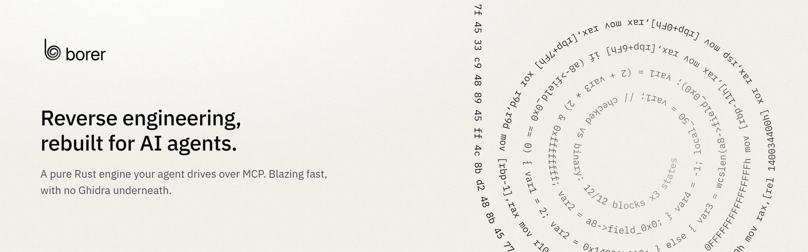

<p align="center">
  <a href="https://borer.lol">
    <picture>
      <source media="(prefers-color-scheme: dark)" srcset="brand/banner-dark.png">
      
    </picture>
  </a>
</p>

<p align="center">
  <a href="https://github.com/imjustprism/borer/releases/latest"></a>
  <a href="https://github.com/imjustprism/borer/actions/workflows/ci.yml"></a>
  <a href="LICENSE"></a>
  
  
  
</p>

<p align="center">
  <a href="https://borer.lol"><b>borer.lol</b></a> &nbsp;·&nbsp;
  <a href="https://borer.lol/docs">Docs</a> &nbsp;·&nbsp;
  <a href="#install">Install</a> &nbsp;·&nbsp;
  <a href="https://borer.lol/docs/tools">Tools</a> &nbsp;·&nbsp;
  <a href="https://borer.lol/llms.txt">llms.txt</a>
</p>

borer is a reverse-engineering engine built for AI agents. It gives an agent
what a human reverse engineer brings to a binary: it finds the code that
matters, reads it as C, follows data through it and writes down what it
learned. It is one Rust binary: an MCP server when run with no arguments, a
command-line tool with them. There is no GUI, and no Ghidra, IDA or Binary
Ninja underneath.

> [!WARNING]
> borer is an early-stage project. Expect bugs and rough edges, and expect
> tool names, output and resource URIs to change between releases. See
> [Limits](#limits), and please report anything that looks wrong.

## Why borer exists

Most software that matters ships as binaries nobody can read: malware, closed
firmware, game clients, drivers, the third-party libraries inside every
product. Reading them takes reverse engineers, and there are far too few of
them for the volume of code that needs reading. A malware analyst triages a
handful of samples a day while millions arrive. A vulnerability researcher
audits one component while the attack surface around it keeps growing.

Agents can read code all day without tiring. What they lack is a tool made
for them. The existing disassemblers were built for a person at a screen:
interactive GUIs, state hidden in a project database, output sized for eyes
rather than a context window, and answers an agent has no way to check.

borer is that tool, designed from the start for a reader that is a program:

- **Answers an agent can trust.** Every block of decompiled C is run in an
  emulator from seeded states and compared with the machine code it came
  from, and the output says how much was checked. Instructions it cannot
  model stay as `/* asm: ... */` instead of a guess. An agent that knows
  which lines are proven can build on them.
- **Built for a context window.** Every list is filtered and paged on the
  server and says `# showing N of M`. A repeated request with `since=<tag>`
  returns only what changed. The same question gives the same bytes every
  time.
- **Fast enough to read everything.** A whole binary loads and decompiles in
  seconds, so an agent can sweep every function instead of guessing where to
  look.
- **Safe on hostile input.** No clock, no random seed, bounds-checked reads,
  capped scans and fuel-limited walks: a malformed or malicious file gets an
  error, never a crash. The binary is never modified, and annotations are
  dry-run by default.
- **Its own engine.** The analysis, lifters, emulator, structurer and
  decompiler are written from scratch in Rust for this purpose, so every
  layer can be shaped around what an agent needs. Only instruction decoding
  and file parsing come from standard crates.

## What it is for

- **Malware analysis.** Triage a sample in one call (what it is, how it is
  packed or protected, where to start), then unpack it, decode its strings,
  pull out its indicators, and write a YARA rule that finds its family
  again.
- **Vulnerability research.** Follow attacker-controlled data from an input
  to where it is used with taint analysis, find the checks between them,
  solve for inputs that reach a path, and diff a patched binary against the
  old one to see what was fixed.
- **Auditing what you ship.** Read the closed-source libraries, drivers and
  firmware inside a product the same way you would read your own code.
- **Understanding software.** Recover class layouts, protocols and message
  formats, and read a running process's objects by their recovered layout.

Formats: PE, ELF, Mach-O, raw code and memory dumps. Architectures: x86,
x86-64 and arm64 for disassembly, decompilation and emulation. 32-bit ARM
(A32 and Thumb-2) for disassembly and decompilation.

## Where it is going

The aim is an agent that takes a binary and returns what a skilled reverse
engineer would: what it does, what is dangerous in it, and the evidence for
each claim.

borer is built to push every measure as far as it will go: faster analysis,
less memory, more of the binary understood, more of the output proven, and
decompiled code closer to the source. When it reaches a limit, the next
step is to move that limit. Each step below moves borer toward that aim:

1. **Decompiled C indistinguishable from source.** Natural loops and
   conditions instead of gotos, recovered types and structures, and text that
   compiles back to the same machine code, with the emulator check kept on
   every line.
2. **Whole-program reasoning.** Data flow, taint and value ranges across
   every function and every call, so an agent asks "can this input reach that
   copy unchecked?" and gets an answer with the path that proves it.
3. **Findings.** Built-in detectors for memory-safety bugs,
   unsafe API use, hard-coded secrets and known malware behaviors, each one
   reported with its path and a proof or a reproducing input.
4. **Scale.** Fleets of agents on huge codebases and sample feeds: shared
   analysis caches, incremental re-analysis when a binary changes, and
   results that diff cleanly between versions.
5. **Every platform.** Wider architecture coverage (32-bit ARM emulation,
   MIPS, RISC-V), managed code (.NET, Java) and firmware images.
6. **Runtime alongside static.** Debugging, tracing and live memory on every
   operating system, so a static claim can be confirmed against the running
   program.

## Install

One command downloads the latest release for your machine, checks it against
the release's SHA256SUMS, and registers borer with every MCP client it finds.

macOS and Linux:

```bash
curl -fsSL https://borer.lol/install | sh
```

Windows (PowerShell):

```powershell
irm https://borer.lol/install.ps1 | iex
```

`setup` finds Claude Code, Claude Desktop, Cursor, Windsurf, Devin Desktop, VS Code, VS Code Insiders, Gemini CLI, Antigravity, Codex CLI, Zed, OpenCode, pi, Copilot CLI, Grok Build, Cline, Roo Code, Kilo Code, Continue, Amp, Qwen Code, Kiro, Factory Droid, Kimi Code, Junie, Augment, Warp and LM Studio.
It backs up each file it edits to `<file>.bak`, replaces an entry whose
program no longer exists (`--replace` replaces any other), and ends by naming
the clients to restart, since none reads its configuration again while it
runs. Quit Claude Desktop from the tray, turn borer on in Cursor under
Settings > MCP, and run `/reload` in pi. For Codex it also sets
`tool_timeout_sec = 600`, and for pi `"timeout": 600`, since the first
analysis of a large binary can take longer than their default minute. pi
also gets `"exposure": "direct"`, so borer's tools are offered like built-in
ones rather than only to codemode.

As a Claude Code plugin, which fetches the binary of the plugin's version
when a session starts and replaces it when the plugin updates:

```text
/plugin marketplace add imjustprism/borer
/plugin install borer@borer
```

Or by hand: download an archive from the
[latest release](https://github.com/imjustprism/borer/releases/latest)
(Windows x64, Linux x64, macOS), move `borer` where it will stay (`setup`
registers the path it runs from), then:

```bash
./borer setup           # show what would change
./borer setup --apply   # register borer with every client found
```

From source, with the toolchain that `rust-toolchain.toml` pins:

```bash
git clone https://github.com/imjustprism/borer
cd borer
cargo build --release
target/release/borer setup --apply
```

To register it by hand, use an absolute path. Claude Desktop, Cursor,
Windsurf, Gemini CLI, Antigravity, Qwen Code, Kimi Code, Junie, Augment,
Warp, LM Studio and Factory Droid read `mcpServers`. Continue reads it too,
from a file of its own (`~/.continue/mcpServers/borer.json`), and Amp reads
it under `amp.mcpServers`:

```json
{ "mcpServers": { "borer": { "command": "/path/to/borer", "args": [] } } }
```

VS Code (`mcp.json` in the user folder) reads `servers`:

```json
{ "servers": { "borer": { "type": "stdio", "command": "/path/to/borer", "args": [] } } }
```

Zed (`settings.json`) reads `context_servers`:

```json
{ "context_servers": { "borer": { "command": "/path/to/borer", "args": [] } } }
```

OpenCode (`~/.config/opencode/opencode.json`) and Kilo Code
(`~/.config/kilo/kilo.json`) read `mcp`, with the command as an array:

```json
{ "mcp": { "borer": { "type": "local", "command": ["/path/to/borer"], "enabled": true } } }
```

pi (`~/.pi/agent/mcp.json`, or `pi mcp add borer -- /path/to/borer`) reads
`mcpServers`:

```json
{ "mcpServers": { "borer": { "command": "/path/to/borer", "args": [], "timeout": 600, "exposure": "direct" } } }
```

Copilot CLI (`~/.copilot/mcp-config.json`) wants a `local` server and its
tools named:

```json
{ "mcpServers": { "borer": { "type": "local", "command": "/path/to/borer", "args": [], "tools": ["*"] } } }
```

Cline (`~/.cline/data/settings/cline_mcp_settings.json`), Roo Code and Kiro
read `mcpServers` with a `timeout` (in seconds, or milliseconds for Kiro),
which `setup` raises for a first analysis.

Codex CLI (`~/.codex/config.toml`) and Grok Build (`~/.grok/config.toml`,
which takes the same table without the timeouts):

```toml
[mcp_servers.borer]
command = "/path/to/borer"
args = []
startup_timeout_sec = 30
tool_timeout_sec = 600
```

To uninstall, `borer setup --apply --remove` takes borer out of every client
(`borer setup --remove` shows what it would change). Then delete the binary
and its cache (`%LOCALAPPDATA%\borer`, or `~/.cache/borer`). The installers
do all three:

```bash
curl -fsSL https://borer.lol/install | sh -s -- --uninstall
```

```powershell
& ([scriptblock]::Create((irm https://borer.lol/install.ps1))) -Uninstall
```

## Use it from an agent

A typical session:

1. `load_binary`
2. `borer://triage` (what the file is, how it is protected, where to start)
3. `find_function_by_string`, `strings` or `symbols`
4. `function_summary`, then `decompile`
5. `xrefs`, `cfg` or `callgraph` to go wider

Any address argument takes `0x` hex, decimal, or a name.

| Area | Tools |
| --- | --- |
| Load | `load_binary`, `binary_info`, `fetch_pdb`, `reload` |
| Find | `functions`, `function`, `symbols`, `strings`, `search`, `find_function_by_string`, `find_crypto_constants`, `entropy` |
| Read code | `function_summary`, `function_strings`, `decompile`, `decompile_batch`, `disassemble`, `disassemble_function`, `cfg`, `callgraph`, `reaches`, `xrefs`, `class_layout` |
| Read data | `read`, `hexdump` |
| Annotate | `set_name`, `set_comment`, `set_type`, `types`, `annotations`, `save_project`, `load_project` |
| Live process (Windows only) | `live_attach`, `live_detach`, `live_modules`, `live_read`, `live_object`, `live_instances`, `live_watch` |
| Anything else | `query`, `script` |

Deeper analyses are `borer://` resources: taint, struct layout, emulation,
input solving, unpacking, flattening, VM dispatch, devirtualization, binary
diff, stack strings, decoded and encoded strings, IOCs, byte signatures and
YARA rules. `borer://help` lists all of them. A client without resource support passes the same URI to `query`.

## Use it from the command line

```bash
borer triage    sample.exe
borer functions sample.exe
borer decompile sample.exe <address|name>
borer xrefs     sample.exe <address|name>
borer verify    sample.exe    # lifter vs emulator, fails on any disagreement
borer help                    # every command
```

Useful flags: `--pack <file>` loads target knowledge, `--no-pdb` skips the
companion PDB, and `--arch x86|x64|arm64` (with `--base`, `--entry` and
`--regions`) maps raw code or a dump.

## More

- **Live processes (Windows only):** `live_attach` opens a running process
  read-only (`PROCESS_VM_READ`) and maps the loaded binary onto it. The live
  tools then read objects by their recovered class layout and watch fields
  change. Some anti-cheat software flags any foreign handle, read-only or not.
- **Packs:** target knowledge (one engine's class names, message ports) lives
  in local `.borer` files, never in engine code. None ship with borer.
  `borer sigmake` builds a signature pack from static libraries you already
  have (COFF `.lib`, ELF `.a`, Rust `.rlib`).
- **Other tools:** `borer sig` writes the shortest byte signature that finds
  a function again (moving bytes wildcarded), `borer yara` a YARA rule from
  functions' signatures and strings, and `borer names <bin> ida|ghidra|binja|x64dbg`
  borer's names and comments as a script or database those tools apply.
  `borer info` gives the MD5, SHA-256, imphash and TLSH, and what any data
  appended past the last section is. `borer addr` converts between virtual
  address, relative address and file offset.
- **Scripting:** sandboxed [Rhai](https://rhai.rs/) scripts (no files, no
  network, an operation budget) through the `script` tool or `borer script`.
- **Sizes:** every answer is capped at 72,000 bytes, cut at a line with a note
  on how to page the rest (`BORER_BUDGET` sets the cap in bytes, `0` lifts
  it). A file is read into memory whole, so one past 1 GiB is refused with a
  message (`BORER_MAX_FILE`, in bytes or with `K`, `M` or `G`, and `0` lifts it).
  A client that sends a progress token gets a progress notification every few
  seconds while a first analysis runs.

## Network access

borer sends nothing about what you analyze, and has no telemetry or crash
reporting. Three things reach the network:

- **The update check.** A command line run at a terminal checks once a day
  whether a newer release is out: a request to
  `https://github.com/imjustprism/borer/releases/latest` with the user agent
  `borer/<version>`, so GitHub sees your IP address, the version and the
  time. It never runs for the MCP server, under `CI`, or with stderr
  redirected, and `BORER_NO_UPDATE_CHECK=1` turns it off.
- **`fetch_pdb`**, only when asked and dry-run by default, sends the PDB's
  name, GUID and age to the symbol server (Microsoft's unless configured).
  `borer doctor` checks that server is reachable unless run as
  `borer doctor offline`.
- **`borer update`** and the installers download the release from GitHub.

## Limits

- No instruction sets beyond x86, x86-64, arm64 and 32-bit ARM.
- 32-bit ARM code is not emulated, so the emulator-backed analyses refuse it.
- On arm64, `taint`, `layout`, `solve`, `unpack` and `devirt` refuse to run.
- Shapes the structurer cannot prove stay as labels and gotos. SIMD code
  prints as intrinsics (`paddd`, `__add_4s`), not as C.
- No debugger: no breakpoints and no writes. Live access is Windows only.
- .NET IL and Swift are not decompiled (.NET metadata is read).
- DWARF supplies names and types, not line tables.
- Embedded containers are listed (`borer://children`), not extracted.
- Library signatures ship for three runtimes only (LLVM compiler-rt, the
  Microsoft C++ standard library, the Rust standard library). Any other
  library needs a pack built with `borer sigmake`.

## Workspace

| Crate | Role |
| --- | --- |
| [`borer-engine`](crates/borer-engine) | The analysis core: loading, lifting, emulation, decompilation. Pure and synchronous: no I/O, no async. |
| [`borer`](crates/borer) | The MCP server and CLI, thin adapters over the engine. |
| [`borer-live`](crates/borer-live) | Read-only access to a running process. |
| [`borer-fixtures`](crates/borer-fixtures) | Programs the tests decompile and check against their source. |

## Contributing

`python scripts/gate.py` runs what CI runs: fmt, clippy with `-D warnings`,
tests, rustdoc, `cargo deny`, typos, ruff and a smoke test of the real server.
The rules for people and coding agents alike are in
[`borer.rules`](borer.rules). Commit titles look like `type: summary`.

By opening a pull request you agree that your contribution is licensed under
the project's license and that the maintainer may relicense it, including under
commercial terms. The details are in [CONTRIBUTING.md](CONTRIBUTING.md).

## License

borer is free software under the [GNU Affero General Public License
v3.0](LICENSE) (AGPL-3.0-only). Use it for anything, change it and share it.
If you distribute borer or a modified version, or run one as a network
service, you must publish its complete source under the same license.
Versions 0.1.0 and 0.1.1 were released under MIT. A commercial license, for
uses the AGPL does not fit, is available: open an issue or reach out on
GitHub.

Third-party notices (pefile ordinal tables, the TLSH reference
implementation, the library signature sets and the SDK type data, with their
provenance) are in [NOTICE](NOTICE). Each release archive also carries
THIRD-PARTY-LICENSES, the licenses of every crate and runtime the binary links.

Ghidra is a project of the NSA. IDA and Hex-Rays are trademarks of Hex-Rays
SA, Binary Ninja is a trademark of Vector 35, and Claude is a trademark of
Anthropic. Other names are their owners' trademarks. borer is not affiliated
with or endorsed by any of them.
